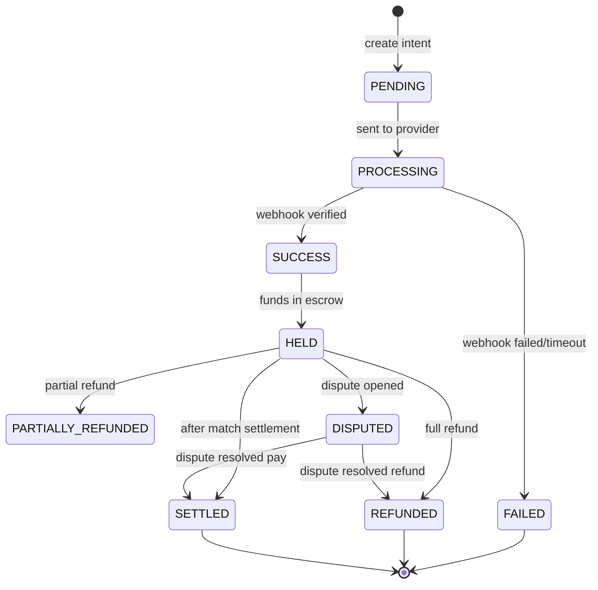

# E-GAROON — Payment Design

**Version:** 1.0  
**Providers:** WaafiPay, DahabPay (target); `mock` (MVP)  
**Related:** [05-business-rules.md](./05-business-rules.md), [15-booking-state-machine.md](./15-booking-state-machine.md), [10-database-design.md](./10-database-design.md)

---

## 1. Architecture

```text
E-GAROON
      │
      ├── PaymentService
      │        │
      │        └── PaymentProviderFactory
      │                 ├── WaafiPayAdapter
      │                 ├── DahabPayAdapter
      │                 └── MockAdapter (dev/MVP)
      │
      ├── SettlementService
      └── PayoutService
```

**Rule:** BookingService never imports provider-specific SDKs. All provider logic lives in adapters implementing a common interface.

---

## 2. Payment Flow

```text
Team A                          Team B
  │                               │
  ├─ Create Booking (HELD)        │
  ├─ POST /payments               │
  ├─ Redirect to Provider         │
  ├─ Webhook → verify → HELD      │
  ├─ Invite Team B ──────────────►│
  │                               ├─ POST /payments
  │                               ├─ Provider pay
  │                               └─ Webhook → verify
  │                                       │
  └──────── Both PAID ────────────────────┘
                    ↓
            Booking CONFIRMED
                    ↓
              Match features ON
```

---

## 3. Payment State Machine



**Booking status and payment status are separate fields** — do not merge into one enum.

---

## 4. Escrow Model

Example: 11 players × $1/player per team.

```text
Team A payment = $11  ──┐
Team B payment = $11  ──┼──► Total held = $22 (escrow)
                        │
                   NOT sent to owner yet
                        │
                   Match COMPLETED
                        │
                   SETTLEMENT
```

Funds move: `SUCCESS` → `HELD` (platform escrow) → after settlement → owner payout portion.

---

## 5. Commission & Settlement

**Default commission:** 4% (configurable by Super Admin).

```text
Gross collected     = $22.00
Platform commission = $22 × 0.04 = $0.88
Owner gross share   = $22 - $0.88 = $21.12
Provider fee        = (recorded separately, not merged)
Owner net payout    = owner gross - provider fee - refunds
```

Ledger entries (append-only):

| type | amount | note |
|------|--------|------|
| payment_in | +$11 | Team A |
| payment_in | +$11 | Team B |
| commission | -$0.88 | Platform |
| payout | -$21.12 | Owner |

---

## 6. Owner Payout Timing

```text
MATCH_END (e.g. 8:00 PM)
        ↓
SETTLEMENT_SAFETY_WINDOW (default 75 minutes)
        ↓
PAYOUT_ELIGIBLE (e.g. 9:15 PM)
        ↓
PAYOUT processed
```

Configurable via platform settings (Super Admin). Allows dispute window and no-show review before funds release.

**BR-010:** No payout while `DISPUTED`.

---

## 7. Webhook Processing

```text
POST /api/v1/webhooks/payments/{provider}
  1. Read raw body (for signature)
  2. adapter.verifyWebhook(headers, body)
  3. Parse event → paymentId, status, providerRef
  4. IF eventId in processedEvents → 200 OK (no-op)
  5. BEGIN transaction
  6. Update payment status
  7. BookingService.evaluatePaymentImpact(payment)
  8. Append audit log
  9. COMMIT
  10. Emit Socket.IO events
  11. 200 OK
```

Requirements: authenticate via signature, validate schema, idempotent (NFR-007), log all events.

---

## 8. Security Rules

| Rule | Detail |
|------|--------|
| Never trust client | No `{ paymentStatus: "SUCCESS" }` from frontend |
| Server calculates amount | PricingService at payment creation |
| Idempotency key | Client or server generates; duplicate POST returns same intent |
| Production | Mock confirm endpoint disabled |
| Credentials | Env vars only |

---

## 9. Provider Adapter Interface

```javascript
// Conceptual — see 09-lld.md
class PaymentProvider {
  get name() {}
  async createIntent({ amount, currency, metadata, returnUrl }) {}
  verifyWebhook(headers, rawBody) {}
  parseWebhookEvent(rawBody) {}
  async refund(providerRef, amount) {}
}
```

### WaafiPay / DahabPay

- Implementations in `providers/payment/WaafiPay/` and `DahabPay/`
- Each encapsulates: API base URL, auth headers, signature algorithm, status mapping

---

## 10. Refunds & Disputes

- Refund initiates from admin dispute resolution.
- Partial refund → `PARTIALLY_REFUNDED`; recalculate settlement.
- Full refund before match → release slot per booking rules.

---

## 11. Receipts & Invoices (FR-017)

On `SUCCESS`/`HELD`: generate receipt record with booking code, teams, amount, timestamp, provider ref. PDF/email — planned.

---

## 12. MVP Status

| Feature | Status |
|---------|--------|
| Payment intent creation | ✅ |
| Mock provider + dev confirm | ✅ |
| Webhook endpoint scaffold | ✅ |
| Escrow HELD status | ✅ |
| Settlement math (4%) | ✅ |
| WaafiPay adapter | ❌ Planned |
| DahabPay adapter | ❌ Planned |
| Automated payout job | ❌ Planned |
| Receipt PDF | ❌ Planned |
