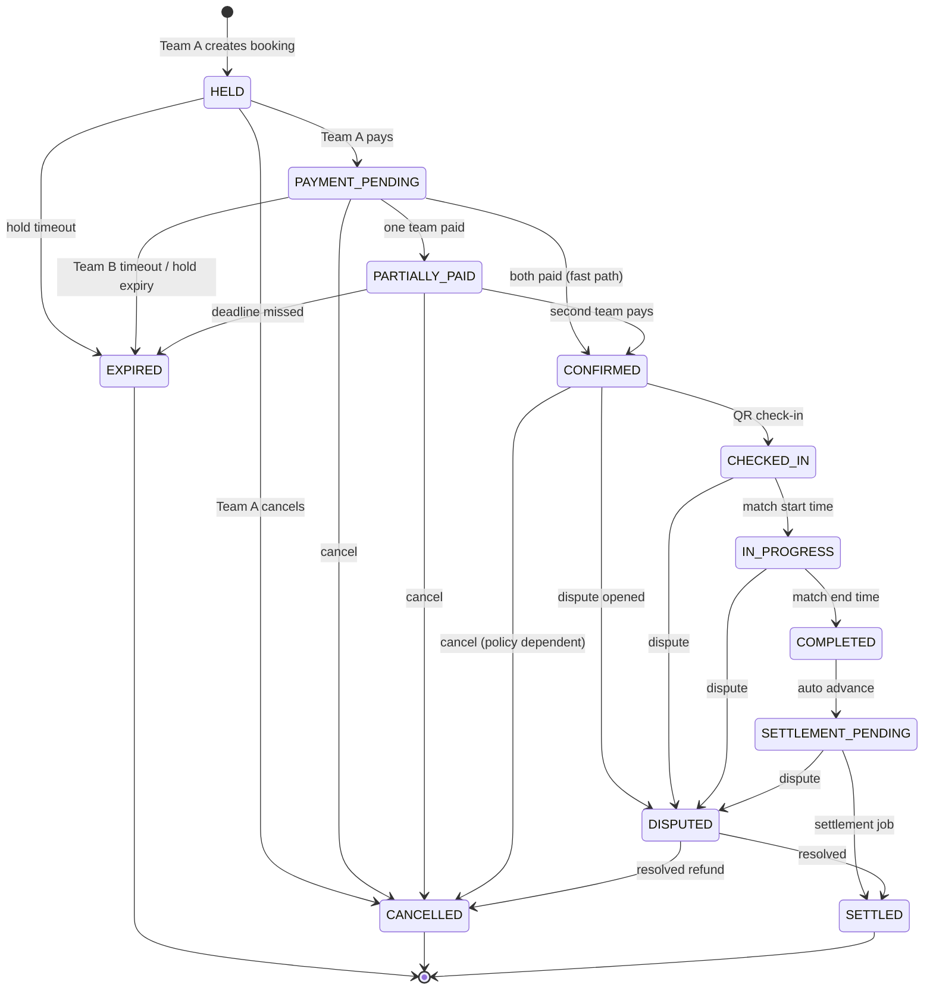

# E-GAROON — Booking State Machine

**Version:** 1.0  
**Related:** [14-payment-design.md](./14-payment-design.md), [05-business-rules.md](./05-business-rules.md), [10-database-design.md](./10-database-design.md)

---

## 1. Core Principle

Three separate layers:

```text
Payment Status     (payments collection — per team)
Booking Status     (bookings collection — match lifecycle)
Feature Permission (computed — lineup, QR, etc.)
```

Never use a single `status` field for both payment and booking.

---

## 2. Booking States

| State | Description |
|-------|-------------|
| `AVAILABLE` | Not a DB state — computed for slot UI |
| `HELD` | Team A reserved slot; hold timer running |
| `PAYMENT_PENDING` | Team A paid or hold active; awaiting Team B payment |
| `PARTIALLY_PAID` | One team paid, other pending (optional explicit state) |
| `CONFIRMED` | Both teams paid and verified |
| `CHECKED_IN` | QR check-in completed (one or both teams per rules) |
| `IN_PROGRESS` | Match start time reached |
| `COMPLETED` | Match end time passed |
| `SETTLEMENT_PENDING` | Awaiting settlement job |
| `SETTLED` | Commission split; owner payout scheduled/done |
| `CANCELLED` | Cancelled by user or admin |
| `EXPIRED` | Hold or Team B deadline expired |
| `DISPUTED` | Dispute opened; blocks payout |

---

## 3. Booking State Diagram



---

## 4. ASCII Flow (Happy Path)

```text
AVAILABLE (slot)
     │
     ▼
  [HELD] ──── 10 min hold ────► EXPIRED → slot AVAILABLE
     │
     ▼ Team A pays
[PAYMENT_PENDING]
     │
     ▼ Invite Team B → Team B pays (10 min default)
     │
     ▼ both verified
 [CONFIRMED] ──── lineup/formation/positions ENABLED
     │
     ▼ QR scan
 [CHECKED_IN]
     │
     ▼ start time
 [IN_PROGRESS]
     │
     ▼ end time
  [COMPLETED]
     │
     ▼ settlement job (+ 75 min safety window for payout)
[SETTLEMENT_PENDING]
     │
     ▼
   [SETTLED]
```

---

## 5. Payment States (Separate Machine)

See [14-payment-design.md](./14-payment-design.md):

```text
PENDING → PROCESSING → SUCCESS → HELD → SETTLED
                    ↘ FAILED
HELD → REFUNDED | PARTIALLY_REFUNDED | DISPUTED
```

---

## 6. Feature Permission Matrix

| Feature | HELD | PAYMENT_PENDING | CONFIRMED | CHECKED_IN+ |
|---------|:----:|:---------------:|:---------:|:-----------:|
| View booking | ✅ | ✅ | ✅ | ✅ |
| Pay (own team) | ✅ | ✅ | ❌ | ❌ |
| Invite Team B | ✅* | ✅ | ❌ | ❌ |
| Lineup / formation | ❌ | ❌ | ✅ | ✅ |
| Digital match pass / QR | ❌ | ❌ | ✅ | ✅ |
| Check-in | ❌ | ❌ | ✅ | ✅ |
| Cancel | ✅ | ✅ | policy | ❌ |

*After Team A action per business rules.

**Enforcement:** `BookingService.assertFeaturePermission(booking, feature)` in service layer — not only UI hiding.

---

## 7. Timers & Expiry

| Timer | Default | Setting / env |
|-------|---------|---------------|
| Initial hold (Team A unpaid) | 10 min | `bookingHoldMinutes` / `BOOKING_HOLD_MINUTES` |
| Team B **priority** (after Team A split pay) | 12 min | `teamBPriorityMinutes` |
| No-demand grace extension | 10 min × max 2 | `teamBGraceMinutes` / `teamBMaxGraceExtensions` |
| Final grace (demand present) | 3 min | `teamBFinalGraceMinutes` |
| SlotDemand TTL | 180 s | `slotDemandTtlSeconds` |
| No-show grace | 15 min | `NOSHOW_GRACE_MINUTES` |
| Payout safety window | 75 min | `SETTLEMENT_SAFETY_MINUTES` |

### Opponent window state (`booking.opponentWindow.phase`)

```text
PRIORITY ──(no demand @ end)──► GRACE (extend, up to max)
PRIORITY / GRACE ──(demand)──► FINAL_GRACE
FINAL_GRACE / 5th demand ──► CLOSED + booking EXPIRED
Team B pays ──► CONFIRMED (phase CLOSED)
```

Job `expireStaleHolds()`:
- Unpaid Team A holds: expire when `holdExpiresAt` past (hard)
- Team A paid waiting for Team B: **`processStaleOpponentWindows()`** — demand eval (extend / final grace / release). Never hard-cancel solely at priority end.
- Protects Team B `PROCESSING` payments
- Releases Redis/Mongo slot lock only after EXPIRED transition

Also evaluated **on GET booking** and payment initiate when deadline passed.

---

## 8. Concurrency Control

```text
1. Redis SET NX EX on slot key (fast reject)
2. AvailabilityService conflict check
3. MongoDB insert with partial unique index (authoritative)
4. On duplicate key → release Redis, return 409
```

> Redis lock alone is **not** sufficient for booking uniqueness.

---

## 9. Team A + Team B Sequence

```text
Team A: POST /bookings                    → HELD
Team A: POST /payments (share)            → Match Code SG-XXXX-XXXX + PRIORITY window
        (messageSo waiting for Team B)
Team B: GET  /bookings/match-code/:code   → preview (Team A paid, amount due, slot)
Team B: POST /bookings/join-by-code       → attached as Team B
   OR Team A: POST /invite-team-b {phone}
Team B: POST /payments                    → Team B payment
Webhooks verify both                      → Booking CONFIRMED + QR receipt
```

**Alternate — Team A covers full match:**
```text
Team A: POST /bookings
Team A: POST /payments { coverFullMatch: true } → amount = totalPrice
Webhook SUCCESS → coveredFullMatch=true, status=CONFIRMED (no Match Code window / no Team B pay)
```

**Demand path (competing captain):**
```text
Team C: POST /bookings (same field+start) → SlotDemand recorded (idempotent)
         → escalating alerts @ 2/3/4; @5 release + Team A wallet credit
Team C then creates NEW hold as NEW Team A (new Match Code) — does not join old booking
```

If Team B not joined yet and Team A pays **only their share**:
- Booking remains `PAYMENT_PENDING` with open Match Code until Team B joins + pays (or window releases).

---

## 10. Cancellation Rules

| From state | Who can cancel | Slot effect |
|------------|----------------|-------------|
| HELD | Team A | Released |
| PAYMENT_PENDING | Team A, admin | Released; refund policy applies |
| CONFIRMED | Admin / policy | Refund workflow; slot may reopen |

Refund amounts governed by dispute/refund module — not automatic in MVP.

---

## 11. MVP Implementation Notes

Current server implements core transitions:

```text
HELD → PAYMENT_PENDING → CONFIRMED → CHECKED_IN → IN_PROGRESS → COMPLETED → SETTLED
  ↓          ↓
EXPIRED   CANCELLED
```

- `expireStaleHolds`: manual admin endpoint (cron planned)
- `PARTIALLY_PAID`, `SETTLEMENT_PENDING`, `DISPUTED`: planned states
- Match pass QR displays at CONFIRMED on client

See `server/README.md` and `server/src/constants/` for exact enum values in code.
